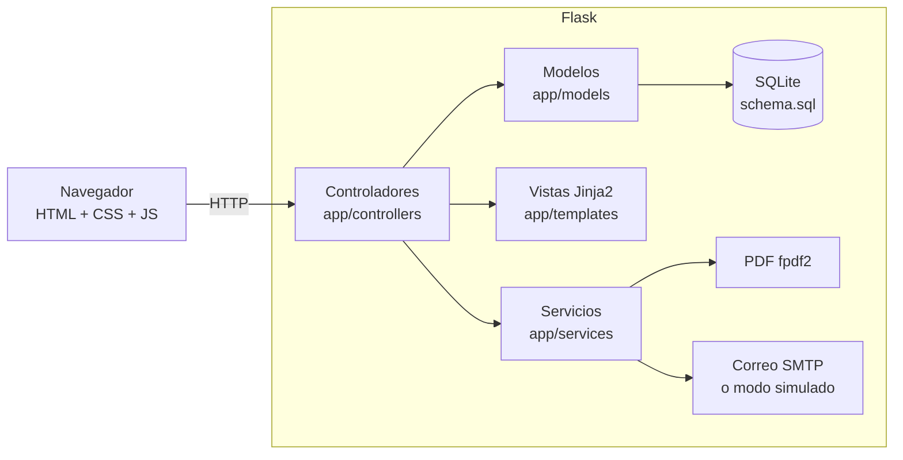

# Arquitectura

Aplicación monolítica **MVC** en Flask, desplegable como un único proceso con una base SQLite.

## Capas
| Capa | Carpeta | Responsabilidad |
|---|---|---|
| Modelo | `app/models/` | Reglas de negocio y SQL parametrizado. Lanzan `ReglaError` con mensajes aptos para el usuario. |
| Vista | `app/templates/`, `app/static/` | Plantillas con macros accesibles (`_macros.html`), CSS adaptable y JS mínimo (mejora progresiva). |
| Controlador | `app/controllers/` | Rutas (blueprints), validación de permisos, traducción de `ReglaError` a mensajes `flash`. |
| Servicios | `app/services/` | Seguridad (sesión, CSRF, cabeceras), validadores, PDF y correo. |

Blueprints: `auth` (público), `portal` (`/socio`), `admin_core` (socios, usuarios, reglas, notificaciones), `admin_ops` (instalaciones, reservas, calendario, ocupación, invitados) y `admin_cobros` (membresías, cuentas, morosos).

## Flujo de una petición
1. `cargar_usuario` identifica al socio o administrador desde la sesión.
2. `verificar_csrf` exige el campo `_csrf` en todo POST.
3. El controlador comprueba permisos (decoradores `socio_requerido` / `admin_requerido`).
4. El modelo valida reglas y persiste; si falla, el controlador muestra el mensaje y vuelve a pintar el formulario.
5. `cabeceras_seguridad` añade CSP y `no-store` en áreas privadas.

## Decisiones de diseño
- **Reglas configurables:** valores operativos (intentos de login, plazos, límites de invitados, cuotas, aforos) viven en tablas, no en el código; se editan en Administración → Reglas (ver [REGLAS_NEGOCIO.md](REGLAS_NEGOCIO.md)).
- **Integridad en la base:** `CHECK`, claves foráneas y **índices únicos parciales** (una membresía vigente por socio, un cargo de cuota por periodo, un cargo por servicio y reserva).
- **Seguridad:** contraseñas con hash de werkzeug; bloqueo temporal por intentos; token de recuperación guardado como hash, de un solo uso y válido 60 min; respuesta de recuperación que no revela si el correo existe; sesión limpiada al iniciar sesión; CSP sin JS ni estilos en línea; SQL siempre parametrizado.
- **Accesibilidad:** enlace «saltar al contenido», `label` en todos los campos, tablas con `scope`, mensajes con `role`, estados con texto (no solo color), foco visible y diseño móvil primero.
- **Rendimiento:** sin frameworks JS, CSS único, consultas indexadas; el JS es opcional.
- **Correo:** si no hay SMTP configurado, la notificación se guarda en el historial como `simulado`, de modo que el flujo se pueda demostrar sin servidor de correo.

## Limitaciones conocidas
- SQLite con varios procesos de gunicorn: la validación de traslapes y el insertado no son una única transacción atómica; con carga alta podría darse una doble reserva simultánea. Mitigación futura: transacción `BEGIN IMMEDIATE` o motor cliente-servidor.
- No hay cola de tareas: `flask tareas-diarias` debe programarse externamente.
- Pagos solo manuales (según el alcance).
