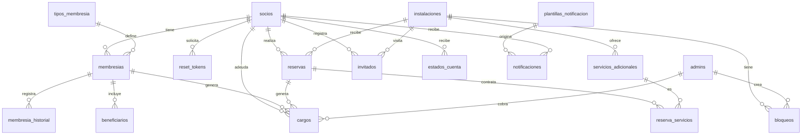

# Modelo de datos

Esquema completo en `app/schema.sql`. Fechas en texto ISO, horas `HH:MM`.

## Diccionario resumido
| Tabla | Propósito | Restricciones destacadas |
|---|---|---|
| `config_club` | Reglas operativas clave/valor | PK `clave` |
| `tipos_membresia` | Cuota, límite de invitados/mes, máx. beneficiarios, autoservicio | `tipo` ∈ individual, familiar, corporativa, honoraria |
| `socios` | Datos personales, hash de clave, intentos y bloqueo | `cedula` y `correo` únicos; estado activo/suspendido/desactivado |
| `reset_tokens` | Recuperación de contraseña (hash, expiración, uso) | `token_hash` único |
| `admins` | Administradores y rol | rol general/instalaciones/cobros |
| `membresias` | Membresía del socio | estado activa/suspendida/vencida/baja; **una vigente por socio** (índice parcial) |
| `membresia_historial` | Cambios de estado y datos | — |
| `beneficiarios` | Familiares de la membresía familiar | límite por tipo |
| `instalaciones` | Golf, tenis, piscina, salón; horario, aforo, modo exclusiva/compartida | `aforo_max > 0` |
| `servicios_adicionales` | Servicios con costo por instalación | — |
| `bloqueos` | Mantenimiento o eventos que cierran una franja | — |
| `reservas` | Reserva de un socio | estados pendiente/confirmada/cancelada/finalizada; índices por instalación-fecha |
| `reserva_servicios` | Servicios contratados y su costo al momento | — |
| `invitados` | Invitados registrados por fecha de visita | — |
| `cargos` | Cuotas y servicios por periodo `YYYY-MM` | estado pendiente/pagado/anulado; únicos: cuota por periodo, servicio por reserva |
| `estados_cuenta` | Estado de cuenta generado por socio y periodo | — |
| `plantillas_notificacion` | Asunto/cuerpo con variables `{nombre}` | editables |
| `notificaciones` | Historial de envíos (enviado/simulado/error) | — |
